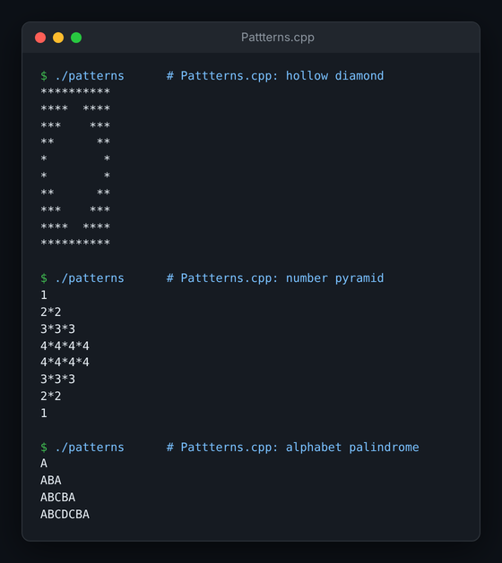
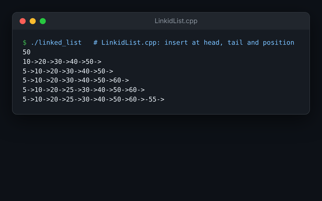

# DSA in C++

Practice code from learning data structures and algorithms in C++: one file per topic, written while working through the fundamentals.


## Output

| Pattern printing (`Pattterns.cpp`) | Linked list operations (`LinkidList.cpp`) |
|:---:|:---:|
|  |  |

<sub>Real output of the first programs in each file, compiled with g++.</sub>

## Contents

| Area | Files |
|---|---|
| Basics & math | `Basic_Math.cpp`, `Functons.cpp`, `Boilerplatecode.cpp` |
| Arrays & strings | `array.cpp`, `2D Array.cpp`, `Vectors 1D Array.cpp`, `Character Array.cpp`, `College array practice.cpp` |
| Searching | `Binary Search.cpp`, `Binary Search 2D Array.cpp` |
| Recursion | `Recursion.cpp` |
| Pointers | `pointers.cpp` |
| Linked list, stack, queue | `LinkidList.cpp`, `stack.cpp`, `Queue.cpp` |
| Trees | `Trees.cpp` (binary tree node and construction) |
| Hash maps | `Unordered Map.cpp` |
| Pattern printing | `Pattterns.cpp` |
| OOP | `OPPS/` (`BasicsDay1.cpp`, `BasicsDay2.cpp`) |
| Scratch | `new.cpp`, `new2.cpp` |

## Running the code

Requires a C++ compiler (g++ / clang++ / MSVC).

Most topic files are **notebooks of several small programs**, each with its own `int main()`, written one after another while practising. To run one of them, copy that program (its `#include` lines and its `main`) into its own file, or comment out the others, then compile:

```bash
g++ -std=c++17 program.cpp -o app && ./app
```

Files with a single program, such as `Binary Search 2D Array.cpp`, `College array practice.cpp`, `Unordered Map.cpp` and `Boilerplatecode.cpp`, compile directly (quote names that contain spaces):

```bash
g++ -std=c++17 "Binary Search 2D Array.cpp" -o app && ./app
```

## Author

Sanket Mali · [GitHub](https://github.com/Sanket1516)
